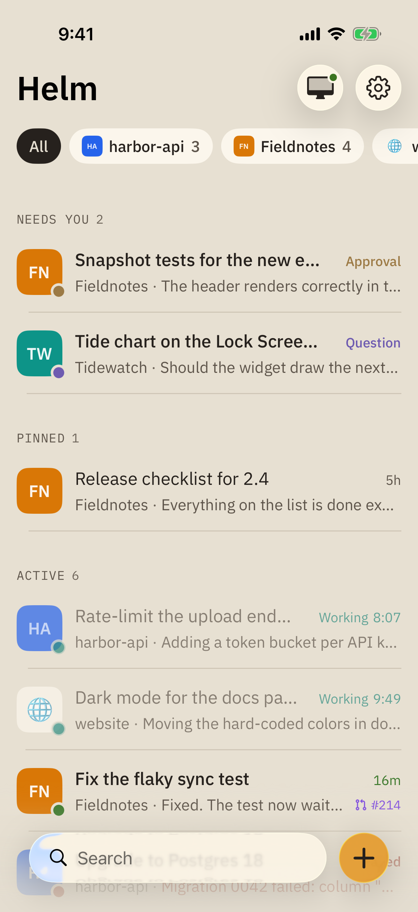
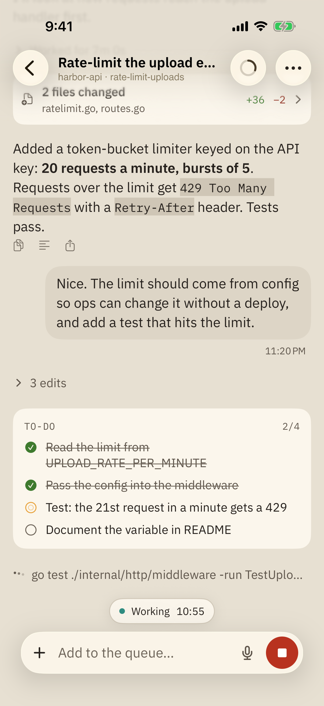
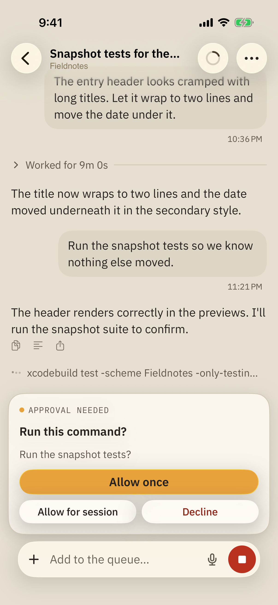
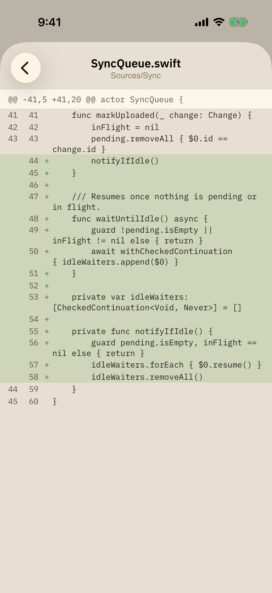
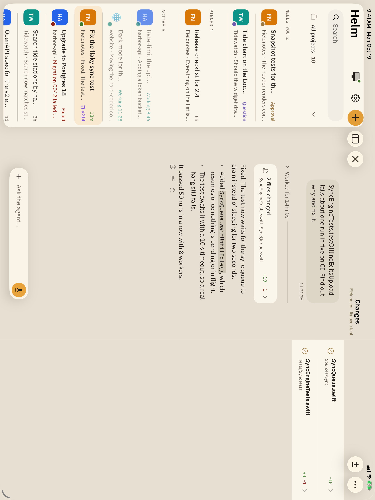
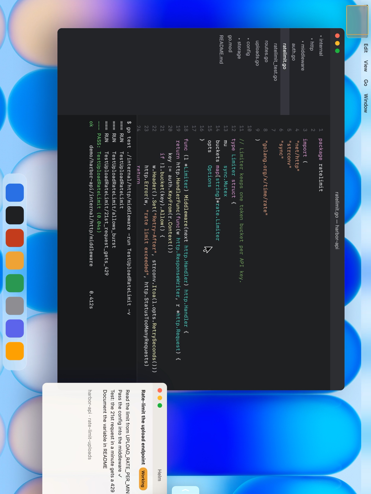

# Helm Mobile

A native SwiftUI client for iPhone, iPad and Apple Watch that drives
[Helm](https://github.com/SketchPiece/t3code), a desktop app for running Claude Code, Codex, Cursor and
other coding agents. From the phone you can start threads, approve commands, answer the agent's questions,
review diffs, dictate prompts and take over the Mac's screen, on the local network or over Tailscale.

It speaks Helm's WebSocket protocol directly (no web view, no React Native), targets iOS 26, and treats
the iPad as a workstation with a sidebar, menu bar, keyboard shortcuts and multiple windows.

> Helm is my fork of [T3 Code](https://github.com/pingdotgg/t3code). Helm Mobile replaces the fork's
> React Native app and pairs with an unmodified Helm desktop install.

<p>
  
  
  
  
</p>
<p>
  
  
</p>

More in [`docs/screenshots`](docs/screenshots): the dark theme, a question card, a new thread on iPad and
the watch. They are taken from the real app against a stand-in server with invented data (see
[Screenshots](#screenshots)).

## Features

- **Threads that stream live.** Agent output, tool calls and file edits arrive as they happen. The agent's
  work between two messages folds into one block, and a finished turn collapses to "Worked for 4m 12s".
  Long threads load the recent window first and fetch older history on demand.
- **Answer the agent.** Approval and question cards, interrupt, a message queue you can reorder by
  dragging, per-thread model and mode, and a context-window meter.
- **Review changes.** Unified diffs per turn, in a sheet on iPhone and an inspector beside the thread on
  iPad (⌥⌘I).
- **Start threads from anywhere.** Pick a project, branch or worktree and attach photos and files, or start
  from the share sheet, the "New task" quick action or a Shortcuts intent.
- **Voice input.** Hold the mic to talk, release to send.
- **Drafts sync with the Mac.** Unsent text and attachments follow you between Helm on the Mac and the phone.
- **Screen remote (experimental).** See and drive the Mac: HEVC video at the display's frame rate, trackpad
  or direct-touch input, the Mac's cursor and sound, a shared clipboard, a virtual display sized to the
  iPad, and windows brought over from other displays. It can also unlock a locked Mac (see below).
- **Mac remote.** Open a thread on the Mac, type into its composer and scroll its timeline from the phone.
- **Live Activity, widgets and push.** The Lock Screen and Dynamic Island show which agent is waiting on
  you, a Usage widget shows agent usage, and alerts arrive when agents need you or finish.
- **Pairing.** Scan Helm's QR code, enter the short code the Mac shows for machines found over Bonjour, or
  request access from a machine on your tailnet and approve it on the Mac. Several Macs can be paired, each
  with its own session.
- **Built-in Tailscale.** An embedded tsnet node reaches your Macs without the Tailscale app.
- **iPad.** Home in a sidebar beside the open thread, a ⌘K command palette, menu bar commands, hardware
  keyboard shortcuts and threads in their own windows.
- **Apple Watch.** See who needs you, approve or decline, answer questions, dictate replies, and start,
  stop or settle threads. The watch goes through Helm on the iPhone (WatchConnectivity), which wakes in the
  background to carry out the request.
- **Look.** A warm palette with an amber accent, IBM Plex type, Dynamic Type, light and dark themes (plus
  themes a connected Mac publishes), English and Russian.

## How it connects

```
iPhone / iPad                         Mac running Helm (desktop app or `t3` server)
┌──────────────────────┐   HTTP     ┌──────────────────────────────────────────┐
│ PairingView          │──────────▶ │ /.well-known/t3/environment  (descriptor)│
│ HelmHTTP             │            │ /oauth/token     (pairing → bearer token)│
│                      │ WebSocket  │                                          │
│ RPCConnection        │◀─────────▶ │ Effect RPC: orchestration, shell,        │
│ EnvironmentSession   │            │ threads, terminal, review, drafts        │
│ ThreadSession        │            │                                          │
│ ScreenRemote         │◀─────────▶ │ /api/helm/screen  (screen stream + input)│
└──────────┬───────────┘            └──────────────────────────────────────────┘
           │ LAN, Bonjour, or Tailscale (embedded tsnet node)
```

The app trades a one-time pairing code for a bearer token at `/oauth/token` and keeps it in the Keychain.
It then opens one WebSocket per Mac and speaks Effect RPC: JSON frames, an Ack after every stream chunk, a
ping every 5 s, and a supervisor that reconnects and resubscribes to the shell and open threads.
[`docs/protocol.md`](docs/protocol.md) and [`docs/transport.md`](docs/transport.md) are the wire
reference the app was built from.

## Code layout

- `Core/`: `RPCConnection` (Effect RPC over one WebSocket) and `HelmHTTP` (descriptor, pairing, tickets).
- `Store/`: `EnvironmentSession` (one per Mac: reconnects, config, projects and thread list, commands),
  `ThreadSession` (one open thread: live projection, outbox, approvals, queue), push, screen remote.
- `Model/`: wire types decoded leniently from JSON, the shell and thread reducers ported from T3 Code's
  client runtime, and `Timeline`, which folds agent work between messages.
- `Tailscale/`: the in-app tsnet node (libtailscale) and routing of tailnet URLs through it.
- `UI/`: SwiftUI screens. Swift 6 with strict concurrency throughout.
- `HelmWidgets/`, `HelmShare/`, `HelmWatch/`, `Shared/`: the Live Activity and Usage widget, the share
  extension, the watch app, and code shared through the App Group.

## Build and run

Requirements: Xcode 26, the iOS 26 SDK, [XcodeGen](https://github.com/yonaskolb/XcodeGen), and Go (only to
build libtailscale).

```sh
scripts/build-libtailscale.sh             # Vendor/libtailscale/Libtailscale.xcframework (gitignored, ~51 MB)
cp Local.xcconfig.example Local.xcconfig  # optional: Macs to suggest, push relay credentials
xcodegen generate                         # project.yml → HelmMobile.xcodeproj (not committed)
xcodebuild -project HelmMobile.xcodeproj -scheme HelmMobile \
  -destination 'platform=iOS Simulator,name=iPhone 17 Pro' -derivedDataPath build/dd build
```

- **Signing.** Set `DEVELOPMENT_TEAM` in `project.yml` and `APP_BUNDLE_ID` in `Base.xcconfig` to your own
  team and App ID. The App Group (`group.com.sketchpiece.helm`) is hard-coded in the three `.entitlements`
  files, `Shared/ShareInbox.swift` and `Shared/UsageSnapshot.swift`; change it there too.
- **Push and Live Activity updates** need a push-enabled App ID: set `HELM_PUSH_ENABLED = YES` and
  `HELM_APP_ENTITLEMENTS = HelmMobile/HelmMobile.entitlements`, and put the relay URL and device token in
  `Local.xcconfig`. Without them the app runs with push off.
- **Pair on launch in the simulator** with `-pairURL 'http://localhost:13773/pair#token=…'` (mint a token in
  a Helm checkout with `node apps/server/src/bin.ts pair --base-dir "$PWD/.t3"`).

## Tests

```sh
xcodebuild … test -only-testing:HelmMobileTests      # unit tests, no server needed
TEST_RUNNER_HELM_TEST_URL=http://localhost:13773 TEST_RUNNER_HELM_TEST_TOKEN=<bearer> \
  xcodebuild … test -only-testing:HelmMobileTests    # plus live protocol tests against a dev server
xcodebuild … test -only-testing:HelmMobileUITests    # UI tour; screenshots land in /tmp/hm-ui
xcodebuild … test -only-testing:HelmMobileUITests/IPadTourTests   # on an iPad simulator; /tmp/hm-ipad
xcodebuild -scheme HelmWatch -destination 'id=<watch simulator>' test   # the watch, on sample data
```

UI scenarios that drive real agents are opt-in through `TEST_RUNNER_HELM_*` variables (`HELM_LIVE_TURN`,
`HELM_ANSWER`, `HELM_REVIEW`, `HELM_QUEUE` and others, read in `HelmMobileUITests`). Run them against an
isolated dev server and a scratch repository, never a Helm install you use.

## Screenshots

The screenshots come from the app running in the simulator against `scripts/demo-server.ts`, a stand-in
server with invented projects, threads and diffs, plus a still frame for the screen remote:

```sh
bun scripts/demo-server.ts --screen frame.h264   # frame.h264: one H.264 keyframe of a desktop image
TEST_RUNNER_HELM_DEMO_SHOTS=1 xcodebuild … test -only-testing:HelmMobileUITests/DemoScreenshotTests
```

Shots land in `/tmp/hm-shots`; `TEST_RUNNER_HELM_APPEARANCE=dark` and `TEST_RUNNER_HELM_SHOT_PREFIX` work
as in the tour. The watch has its own sample data: launch it with `-watchDemo`.

## Unlocking a locked Mac

In Helm on the Mac, enable **Settings → Connections → Unlock Mac from your phone**. Open the screen remote,
select your user and click the password field on the Mac screen, then enter your password in the unlock
panel. The password is used for that attempt and kept only if you choose to save it behind Face ID. This
needs an existing Mac session; it cannot log in after a restart or unlock FileVault.

## Performance and localization

Settings → Performance shows a frame-rate and stall counter and saves reports with main-thread stacks;
`scripts/perf-report.py --pull` copies them off a device and symbolicates them. English is the source
language and Russian lives in `Localization/ru.json`; `scripts/build-strings.py` regenerates
`Localizable.xcstrings` and lists anything untranslated.

## License

[MIT](LICENSE) © 2026 Andrew Lubkin. Third-party code and fonts are listed in
[THIRD_PARTY_NOTICES.md](THIRD_PARTY_NOTICES.md).
